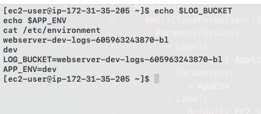

# ec2-log-bucket

A CloudFormation template that creates an EC2 web server and an S3 bucket for its logs.
The bucket name is passed into the server as a system variable, so applications on the
instance can read it from `LOG_BUCKET` (and the environment from `APP_ENV`).

I made this for my master's DevOps course. The assignment did not ask for actually shipping
logs to S3, only for injecting the bucket name into the server, so that part is not included.

## What gets created

| Resource | Type | Notes |
|---|---|---|
| `WebServerLogBucket` | `AWS::S3::Bucket` | name built with `Fn::Sub`, encrypted, public access blocked, old logs expire |
| `WebServerSecurityGroup` | `AWS::EC2::SecurityGroup` | allows SSH (port 22) only from `SSHLocation` |
| `WebServerInstance` | `AWS::EC2::Instance` | Amazon Linux 2023, UserData sets `LOG_BUCKET` and `APP_ENV` |

The bucket name is:

```yaml
BucketName: !Sub ${LogBucketNamePrefix}-${AppEnv}-logs-${AWS::AccountId}-${UniqueSuffix}
```

It starts with `LogBucketNamePrefix` and ends with `UniqueSuffix` (my initials, `bl`). The
account ID in the middle keeps the name globally unique, e.g. `webserver-dev-logs-605963243870-bl`.

## How the variables get to the server

`UserData` uses `Fn::Base64` and `Fn::Sub`. `Fn::Sub` replaces `${WebServerLogBucket}` with the
bucket name (the `Ref` of a bucket is its name) and `${AppEnv}` with the parameter value before
the script reaches the instance:

```yaml
UserData:
  Fn::Base64: !Sub |
    #!/bin/bash -xe
    yum update -y
    echo "LOG_BUCKET=${WebServerLogBucket}" >> /etc/environment
    echo "APP_ENV=${AppEnv}" >> /etc/environment
    cat > /etc/profile.d/app-env.sh <<'EOF'
    export LOG_BUCKET=${WebServerLogBucket}
    export APP_ENV=${AppEnv}
    EOF
```

- `/etc/environment` is read for every login (system-wide variables)
- `/etc/profile.d/app-env.sh` exports them in login shells, so `echo $LOG_BUCKET` works after SSH

## Template sections

The template uses every section CloudFormation supports, including the optional ones:

| Section | What it does here |
|---|---|
| `AWSTemplateFormatVersion` | template format version `2010-09-09` |
| `Description` | short description of the stack |
| `Metadata` | `AWS::CloudFormation::Interface` groups and labels parameters in the console |
| `Transform` | `AWS::LanguageExtensions` macro (needs `CAPABILITY_AUTO_EXPAND`) |
| `Parameters` | all configurable values, nothing hardcoded (see below) |
| `Mappings` | `EnvironmentConfig`: log retention days per environment (dev 7, staging 30, production 90) |
| `Conditions` | `IsProduction` turns on bucket versioning, `HasInstanceProfile` attaches the IAM profile only if one is given |
| `Rules` | blocks `t2.micro` / `t3.micro` when `AppEnv` is `production` |
| `Resources` | bucket, security group, instance |
| `Outputs` | bucket name/ARN, instance ID, public IP/DNS, `AppEnv`, ready-made SSH command (some exported) |

## Parameters

| Parameter | Default | Description |
|---|---|---|
| `AppEnv` | `dev` | `dev`, `staging` or `production` |
| `AmiID` | `/aws/service/ami-amazon-linux-latest/al2023-ami-kernel-default-x86_64` | SSM parameter, resolves to the latest Amazon Linux 2023 AMI in the current region |
| `InstanceType` | `t3.micro` | `t2.micro`, `t3.micro`, `t3.small`, `t3.medium` |
| `KeyName` | `vockey` | existing EC2 key pair for SSH |
| `SSHLocation` | *(required)* | CIDR allowed to SSH, e.g. `203.0.113.10/32` |
| `InstanceProfileName` | `LabInstanceProfile` | existing IAM instance profile, empty for none |
| `LogBucketNamePrefix` | `webserver` | start of the bucket name |
| `UniqueSuffix` | `bl` | end of the bucket name |

`ImageId` uses `!Ref AmiID` and `InstanceType` uses `!Ref InstanceType`, as the assignment asks.
The defaults `vockey` and `LabInstanceProfile` match the AWS Academy Learner Lab, where creating
new IAM roles is not allowed.

## Deploy

You need the AWS CLI configured for `us-east-1` (or any region with the key pair).

```bash
# check the template
aws cloudformation validate-template --template-body file://template.yaml
pipx run cfn-lint template.yaml

# create the stack (SSH only from your current IP)
aws cloudformation deploy \
  --stack-name ec2-log-bucket-dev \
  --template-file template.yaml \
  --capabilities CAPABILITY_AUTO_EXPAND \
  --parameter-overrides \
      AppEnv=dev \
      LogBucketNamePrefix=webserver \
      SSHLocation=$(curl -s https://checkip.amazonaws.com)/32

# show the outputs (bucket name, IP, SSH command)
aws cloudformation describe-stacks --stack-name ec2-log-bucket-dev \
  --query 'Stacks[0].Outputs[].[OutputKey,OutputValue]' --output table
```

## Verify

Download `labsuser.pem` from the Learner Lab (*AWS Details* → *Download PEM*), then:

```bash
chmod 400 labsuser.pem
ssh -i labsuser.pem ec2-user@<PublicDnsName from the outputs>

echo $LOG_BUCKET
echo $APP_ENV
cat /etc/environment
```

Result:



The `Rules` section can be checked by trying production with a micro instance. CloudFormation
rejects it before creating anything:

```
Parameter validation failed: assertion error: Production must use t3.small or larger.
```

## Clean up

```bash
aws cloudformation delete-stack --stack-name ec2-log-bucket-dev
```

The bucket is deleted with the stack as long as it is empty.
